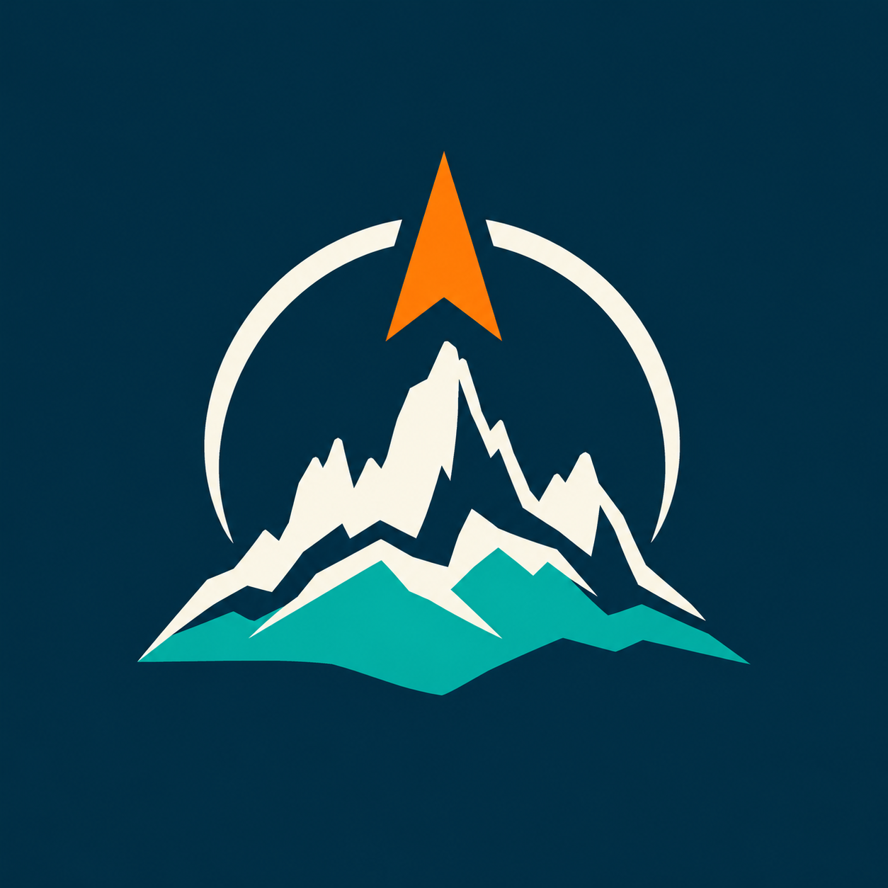

  

<h1 align="center">Rumbo Austral</h1>

  Navegación y gestión de campo para la Patagonia, sin depender de señal.

## Qué es

Rumbo Austral es una app Android pensada para trabajar en terreno: marcar y encontrar
aguadas, esquineros, cercos, animales y cualquier punto del campo; navegar hacia ellos con
una brújula simple; y llevar registro de los recorridos, todo funcionando con mapas
descargados de antemano para las zonas sin cobertura.

No está pensada como una app genérica de mapas, sino como una herramienta de trabajo diario
para quienes recorren el campo.

## Qué permite hacer

- **Puntos (waypoints)**: crear un punto tocando el mapa o parado en el lugar, con nombre,
  notas y una foto de referencia (se guarda liviana, sin ocupar espacio de más).
- **Etiquetas**: clasificar los puntos por tipo, estado y zona, con colores propios, para
  encontrarlos y filtrarlos rápido en el mapa o en la lista.
- **Navegación**: flecha de rumbo hacia cualquier punto guardado, con distancia y estado del
  GPS a la vista.
- **Medición**: distancia entre tu ubicación (o cualquier punto) y la cruz central del mapa.
- **Recorridos**: grabar el camino que hiciste (distancia, duración, velocidad promedio),
  incluso con la pantalla apagada o la app en segundo plano.
- **Mapas sin conexión**: descargar de antemano el área y el nivel de detalle que necesites,
  para seguir viendo el mapa satelital sin datos móviles.
- **Compartir e importar**: enviar un punto o un recorrido como archivo GPX (por WhatsApp,
  correo, etc.), e importar puntos desde un GPX de otra app o de otra persona.

## Instalación

La app no está publicada en Google Play; se instala el APK directamente en el teléfono.

1. Descarga el último APK desde la sección [Releases](https://github.com/Jose-Gallegos/rumboaustral/releases) de este repositorio
   (si todavía no hay ninguno publicado, pídele a quien administra el proyecto que genere uno).
2. En el teléfono, permite instalar aplicaciones de "orígenes desconocidos" si Android lo pide.
3. Abre el archivo `.apk` descargado para instalarlo.

Requiere Android 8.0 (Oreo) o superior.

## Permisos que pide y para qué

- **Ubicación**: para mostrar tu posición, navegar hacia los puntos y grabar recorridos.
- **Cámara**: solo si eliges tomarle una foto a un punto desde la app.
- **Notificaciones**: para avisar que un recorrido se sigue grabando en segundo plano.

Ningún dato se envía a servidores propios: los puntos, fotos y recorridos quedan guardados
en el teléfono.

## Soporte

Este proyecto se mantiene para uso interno. Si encuentras un problema o tienes una idea,
abre un [issue](https://github.com/Jose-Gallegos/rumboaustral/issues) en este repositorio.
